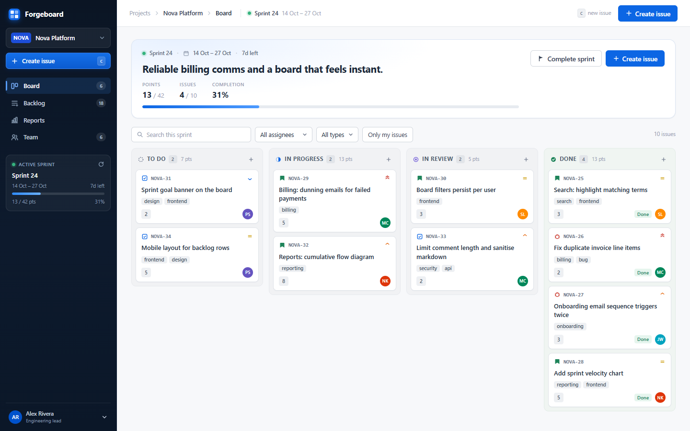
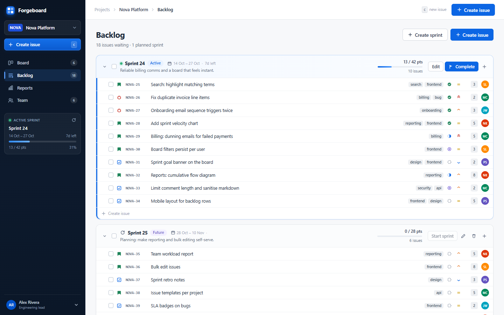
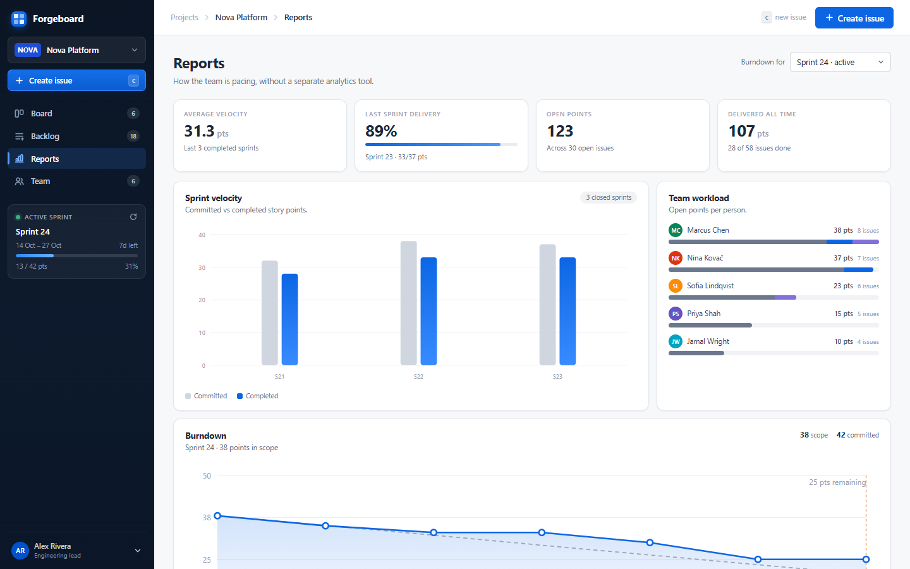

# Forgeboard

A small, self-hosted scrum tool for teams that only need the project-management half of Jira: projects, a ranked backlog, sprints, a drag-and-drop board, issue detail, and sprint reports. No marketplace, no Confluence, no JQL, no enterprise admin surface.



## What it does

Forgeboard keeps the parts of Jira that actually run a team:

- **Projects** with a key (`NOVA-14`), description and next-issue counter.
- **Backlog** ordered by drag-and-drop rank, with collaboration-friendly sprint sections, multi-select, bulk move and bulk delete.
- **Sprints**: create, edit dates and goal, start, complete, delete, and move unfinished work to the backlog or the next sprint.
- **Board**: four workflow columns (To Do, In Progress, In Review, Done), drag cards between columns, create inline, filter by text, assignee, type or "only my issues".
- **Issues**: story, task, bug and epic types; priority, assignee, reporter, story points, labels, sprint and epic links; plain-text descriptions.
- **Issue detail** drawer with inline summary/description editing, comments, and a history timeline that records status, priority, estimate, sprint, labels and epic changes.
- **Reports**: velocity (committed vs completed), sprint burndown, team workload, sprint history and issue mix.
- **Team**: member roster with roles and colours, workload per person, project switching, and the workspace security state.
- **Optional shared passcode** so a public deployment is not wide open.

The model follows Jira's core scrum primitives rather than cloning its configuration surface: work belongs to a project, a sprint is a time box over issues, the board is a view of status, and reports are derived from issue state and resolution timestamps.

| Backlog | Reports |
| --- | --- |
|  |  |

## Run locally

Requirements: Node.js **22.9+**. No external database is needed for development.

```bash
npm install
npm run dev
```

Open <http://localhost:5173>. The first boot seeds a demo workspace (Nova Platform, five sprints, 58 issues, comments and history) so every screen has something in it.

The local database is PGlite, stored in `.data/pg`. Stop the dev server before running seed commands against it:

```bash
npm run seed -- --reset   # wipe and re-seed the demo workspace
```

If you want an empty workspace instead:

```bash
SEED_DEMO=false npm run dev
```

On Windows PowerShell, use `$env:SEED_DEMO="false"; npm run dev`.

Build and run the production server:

```bash
npm run build
npm start
# http://localhost:3000
```

Environment variables are read from the shell or from an optional `.env` file (`.env.example`). `DATABASE_URL` switches the server from PGlite to Postgres.

## Deploy to Render on the free tier

A free Render web service sleeps after 15 minutes without traffic, and Render's own free Postgres **expires 30 days after creation**. The combination below keeps the app free and the data durable:

1. **Create a free Postgres database at [Neon](https://neon.tech)** and copy its pooled connection string. This is `DATABASE_URL`.
2. **Push this repository to GitHub.**
3. In Render, choose **New → Blueprint**, pick the repository and apply [`render.yaml`](render.yaml). Render creates a free Node web service.
4. Fill in the environment variables:
   - `DATABASE_URL` — the Neon connection string.
   - `APP_PASSCODE` — the shared code your team will type.
   - `SESSION_SECRET` is generated by the blueprint.
   - `SEED_DEMO=false` is already set, so your real workspace starts empty.
5. Deploy and open the URL. Sign in with the passcode, create the first project, then add members on the **Team** page.
6. Point a keep-alive at it (below) if you do not want the first request of the day to wait for a cold start.

To deploy manually instead of with the blueprint, use:

- Build command: `npm ci --include=dev && npm run build`
- Start command: `npm start`
- Health check path: `/api/health`
- Node version: `24`

`npm start` serves the built frontend and the API from one process. The server binds to `PORT` and `0.0.0.0`, as Render expects.

### Keep-alive

[`.github/workflows/keep-alive.yml`](.github/workflows/keep-alive.yml) pings `/api/health` every 10 minutes. Add a GitHub repository variable:

```
FORGEBOARD_URL=https://your-service.onrender.com
```

You can trigger the workflow manually the first time. GitHub's scheduled runs are best-effort and can be delayed; if you need tighter guarantees, point a free uptime monitor (for example UptimeRobot) at the same health URL every 5–10 minutes. Note that GitHub disables scheduled workflows on repositories with no activity for 60 days.

## Configuration

| Variable | Purpose |
| --- | --- |
| `DATABASE_URL` | Postgres connection string. If unset, the embedded PGlite database is used. |
| `APP_PASSCODE` | Enables the shared-passcode login screen and protects every `/api` route except health and auth. |
| `SESSION_SECRET` | Signs the session cookie. Set a stable random value in production. |
| `SEED_DEMO` | `false` skips demo seeding on an empty database. |
| `PORT` | HTTP port, default `3000`. |
| `PGLITE_DIR` | Local embedded database directory, default `.data/pg`. |
| `PG_POOL_MAX` | Postgres pool size, default `5`. |

Authentication is deliberately not per-person: Forgeboard is a small-team tool. Everyone uses one passcode, and each person picks themselves from the member list; comments and history entries are attributed to that selection. All records are shared across the instance. Do not store secrets or personal data in issue text.

## Data model

```
members             id, name, email, role, color
projects            id, key, name, description, next_issue_number
sprints             id, project_id, name, goal, state, start_date, end_date,
                    committed_points, started_at, completed_at
issues              id, key, project_id, type, summary, description, status,
                    priority, assignee_id, reporter_id, sprint_id, epic_id,
                    story_points, labels[], rank, resolved_at
comments            id, issue_id, author_id, body, created_at
activity            id, issue_id, actor_id, field, from_value, to_value, created_at
sprint_scope        sprint_id, issue_id, points   (snapshot taken at sprint start)
```

Notes:

- Ranks are floats assigned in increments of 1000; the client sends the full ordered list after a move, so ordering stays deterministic across browsers.
- Status is one of `todo`, `in_progress`, `in_review`, `done`. Moving to Done sets `resolved_at`; moving back clears it.
- Starting a sprint stores committed points and a scope snapshot. Completing a sprint closes it and moves unfinished issues to the backlog or a future sprint.
- Reports are computed from issues, sprints and resolution timestamps; there is no separate reporting store to keep in sync.

## API

All routes are JSON under `/api` and require the session cookie when `APP_PASSCODE` is set.

```
GET    /api/auth/status
POST   /api/auth/login
POST   /api/auth/logout
GET    /api/bootstrap
GET    /api/projects/:id                 project + sprints + issues
POST   /api/projects
PATCH  /api/projects/:id
POST   /api/projects/:id/issues
POST   /api/projects/:id/sprints
POST   /api/projects/:id/reorder         ordered issue ids
GET    /api/projects/:id/reports         optional ?sprintId=
PATCH  /api/issues/:id
DELETE /api/issues/:id
GET    /api/issues/:id                   issue + comments + activity
POST   /api/issues/:id/comments
PATCH  /api/sprints/:id
POST   /api/sprints/:id/start
POST   /api/sprints/:id/complete
DELETE /api/sprints/:id
POST   /api/members
PATCH  /api/members/:id
DELETE /api/members/:id
GET    /api/health                       public, for keep-alive and Render
```

## Project layout

```
server/            Express API, schema, seed, auth, Postgres/PGlite adapter
  db.js            connection + transaction routing (AsyncLocalStorage on Postgres)
  schema.js        DDL, applied idempotently at boot
  seed.js          demo workspace and reset script
src/               React + TypeScript frontend
  components/      board, backlog, reports, team, issue drawer, dialogs
  styles/          design tokens, layout and per-surface CSS
  api.ts           typed API client
render.yaml        Render blueprint
.github/workflows  scheduled keep-alive
```

## Deliberately out of scope

Attachments, real-time collaboration, notifications/email, comments on sprints, epics as swimlanes, custom workflows/fields, JQL, per-user permissions, OAuth/SSO and integrations with Slack, GitHub, Figma or CI. Those are the "external stuff" this tool avoids; the board, backlog, sprint and reporting model is the product.

## Scripts

| Command | What it does |
| --- | --- |
| `npm run dev` | API on :3000 + Vite on :5173 with HMR |
| `npm run build` | Type-checked Vite production build into `dist/` |
| `npm start` | Serve `dist/` and the API from :3000 |
| `npm run seed` | Seed if the database is empty |
| `npm run seed -- --reset` | Wipe and re-seed the demo workspace |
| `npm run typecheck` | `tsc --noEmit` |
